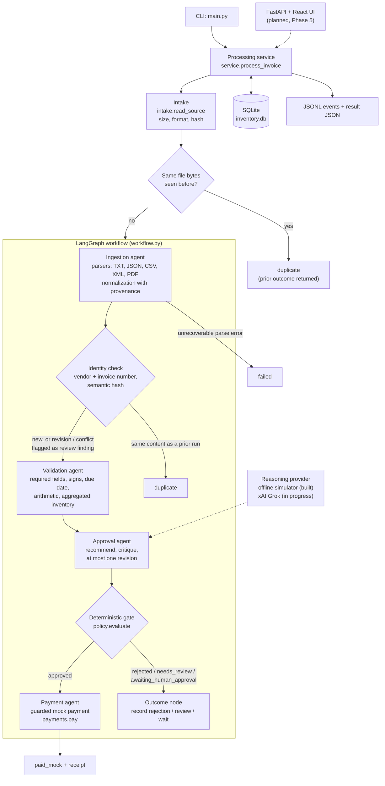

# Architecture

Status (2026-11-01): describes what is on `main`. The offline pipeline (Phases 0–2) is built and tested. Live Grok reasoning and the tool whitelist (Phase 3) are **in progress** on a separate branch; human review operations (Phase 4) and the FastAPI + React UI (Phase 5) are **planned**. Each section says which parts are built and which are not.

Related: [system design](systemsdesign.md) (the target design), [decisions](decisions.md), [limitations](limitations.md), [development](development.md).

## Components and data flow

Step by step, with the module that owns each step:

1. **Intake** (`src/invoice_processing/intake.py`). Checks the path, size limit (10 MiB, `limits.py`), that the extension matches the content, and hashes the bytes. An intake error creates no run. If the same bytes were processed before, the service returns the earlier outcome as `duplicate` without running the graph (`service.py`).
2. **Parsers** (`src/invoice_processing/parsers/`). One parser per format: labeled and tabular TXT (`text.py`, `txt.py`), JSON, field/value and row-table CSV, hardened XML (`defusedxml`), and text PDFs via `pdfplumber`. They produce an `InvoiceDraft` that can hold missing or invalid values plus extraction issues, rather than throwing them away. There is no OCR.
3. **Normalization** (`normalize.py`). Label aliases, item spacing, OCR digit fixes (`2O26` → `2026`), dates, currency and payment terms. Every change records the raw value, the new value, the evidence location and the rule that made it (`rule:label_alias`, `rule:ocr_digit`, …). Missing currency becomes USD with a `currency_assumed_usd` finding.
4. **Identity and duplicate check** (`ledger.check_identity`, called by the ingestion agent). Identity is the normalized vendor plus invoice number. Same semantic content as a prior run is a `duplicate`; changed content after a payment is `revision_after_payment`; changed content of an unpaid identity is `version_conflict`. Both of the last two are review findings, so the gate routes them to `needs_review`.
5. **Validation** (`validation.py`, `agents/validation.py`). Required fields, value signs, due date against the evaluation date, decimal arithmetic (line totals, subtotal, tax, shipping, total; differences over one cent block), and inventory: quantities per item are summed across repeated lines and checked against current stock. Validation reads inventory and never writes it.
6. **Approval agent** (`agents/approval.py`). The reasoning provider makes an initial recommendation, critiques it once, and the critique can revise it once. Today the provider is the offline simulator (`reasoning/offline.py`), a deterministic stand-in whose output is labeled `offline simulation:`. The recommendation and critique are stored in `decisions`.
7. **Deterministic gate** (`policy.py`). The gate decides, not the model. Rules in order: any blocker → `rejected` (a human review never clears it); non-USD or any review finding → `needs_review`; total above USD 10,000.00 or a model recommendation other than approve → `awaiting_human_approval` unless a human approval for the same version and policy version exists; otherwise `approved`.
8. **Guarded mock payment** (`payments.py`, `agents/payment.py`). `payments.pay` is the only caller of `mock_payment`. Inside one write transaction it rereads the persisted decision, checks it is `approved` for this version, USD, and within the threshold or human-approved, checks no payment exists for the invoice identity, calls the mock gateway with the idempotency key `invoice:<id>`, and writes the payment and receipt.

The CLI prints the result JSON to stdout and the mode banner and summary to stderr; every stage writes JSON-lines events (`observability.py`) and audit rows.

## Agents

| Agent | Module | What it does today | Model involvement |
| --- | --- | --- | --- |
| Ingestion | `agents/ingestion.py` | Parse, normalize, record version, identity check | None yet. Model-assisted extraction repair is Phase 3 (in progress). |
| Validation | `agents/validation.py` | All deterministic checks | None; the checks are code. |
| Approval | `agents/approval.py` | Recommend → critique → optional revision → gate | Offline simulator today; Grok in live mode (in progress). |
| Payment | `agents/payment.py` | Pay through the guard, or record the outcome | None, by design: the execution boundary is deterministic. |

## Ledger tables

One SQLite file (default `inventory.db`, schema in `src/invoice_processing/storage.py`, `SCHEMA_VERSION = 4`). Money is stored as decimal strings.

| Table | Holds | Used today |
| --- | --- | --- |
| `inventory` | Item and stock (`stock >= 0`). Seeded with WidgetA 15, WidgetB 10, GadgetX 5, FakeItem 0. | Yes |
| `sources` | One row per distinct file content hash, with extracted text. | Yes |
| `invoices` | Business identity, `UNIQUE (vendor_key, invoice_number_key)`, current status. | Yes |
| `invoice_versions` | Normalized payload and semantic hash per version. | Yes |
| `runs` | One processing attempt: mode, status, error code, prior run. | Yes |
| `findings` | Validation and gate findings with severity and evidence. | Yes |
| `decisions` | Recommendation, critique, final gate decision, policy version, mode. One per run. | Yes |
| `corrections` | Evidence-backed extraction corrections. | Table exists; written in Phase 4 (planned). |
| `human_reviews` | Approve/decline bound to a version and policy version. | Read by the gate and the payment guard; no operation writes it until Phase 4 (planned). |
| `payments` | `UNIQUE (invoice_id)` and `UNIQUE (receipt_id)`: at most one payment per identity. | Yes |
| `audit_events` | Ordered stage events per run, with secret-looking keys redacted. | Yes |

## Offline and live providers

Both modes share intake, parsers, normalization, validation, the gate and the payment guard; a mode never changes business rules ([decision](decisions.md#d-dual-mode)).

- **Offline (built, default).** `reasoning/offline.py` applies the same severity rule the gate uses and labels every summary `offline simulation:`. It imports no model SDK and opens no socket; LangSmith tracing is forced off for offline runs (`service.py`). Tests block network access (`tests/conftest.py`, `tests/test_e2e.py::test_e2e_tracing_env_does_not_reach_network`). It is a simulator, not a model.
- **Live (in progress, Phase 3).** On `main`, `--mode live` exits with code 2 and "live mode is not available until Phase 3" (`reasoning/__init__.py`). The [Phase 3 plan](superpowers/plans/2026-11-01-phase-3-live-grok.md) adds an `XaiProvider` on the official `xai_sdk`, model named by `XAI_MODEL` (never hard-coded), 30 s timeout, at most 6 top-level model steps per invoice, at most 3 tool turns per step, one extraction repair, one critique and at most one revision. A live failure leaves the invoice unpaid with a recoverable error and an explicit retry; it never falls back to the simulator. Live results against the real provider are not yet recorded (P3-10 needs the xAI key).

## Tool whitelist (in progress, Phase 3)

Not on `main` yet. The Phase 3 plan defines exactly six read-only tools, each allowed only for named agents, dispatched through a validator that rejects unknown tools, unauthorized agents and invalid arguments without raising:

| Tool | Allowed agents | Returns |
| --- | --- | --- |
| `lookup_inventory(items)` | validation, approval | Stock per item, `null` if unknown (≤ 200 items) |
| `recompute_totals()` | validation, approval | Deterministic arithmetic for this invoice |
| `get_findings(severity)` | approval | Recorded findings |
| `lookup_prior_invoice()` | validation, approval | Versions, outcomes, payment status for this identity |
| `get_source_excerpt(location)` | ingestion, approval | Bounded excerpt at an evidence location |
| `list_item_aliases()` | ingestion | Known item aliases |

No tool writes, pays or changes policy; handlers get a connection wrapper that only allows `SELECT`. Invoice text is treated as untrusted data, so an injected "approve this" or "stock is 1000" cannot change the gate outcome.

## Safety invariants

These hold in both modes, because they live in code the model never controls:

1. **One payment per invoice identity.** Enforced by `UNIQUE (invoice_id)` on `payments`, the write-transaction recheck in `payments.pay`, and identity checks across formats and revisions. Evidence: `tests/test_payments.py::test_pay_twice_same_receipt_one_call`, `tests/test_acceptance.py::test_shared_ledger_never_pays_an_identity_twice`, `tests/test_robustness_corpus.py` (7 payments for 20 files in either order), `tests/test_robustness_replay.py`.
2. **The model cannot authorize payment.** The recommendation is one input to `policy.evaluate`; blockers reject regardless of it, and a disagreeing recommendation can only hold an invoice for a human, never pay it. `payments.pay` rereads the persisted gate decision. Only `agents/payment.py` imports `pay` (`tests/test_agents.py::test_only_payment_module_imports_pay`), and the graph reaches the payment node only from `approved` (`tests/test_workflow.py::test_payment_unreachable_unless_approved`).
3. **High value waits for a human.** Totals above USD 10,000.00 end `awaiting_human_approval` and are not paid; 10,000.00 exactly pays (`tests/test_robustness_threshold.py`, `tests/test_payments.py::test_high_value_without_human_review_raises`).
4. **Failures never pay.** An exception at any stage before payment ends `failed` with no payment (`tests/test_robustness_injection.py`).
5. **No silent currency conversion.** Non-USD invoices go to `needs_review` and cannot be paid (`tests/test_payments.py::test_non_usd_raises_not_usd`).
6. **Secrets are not logged.** Audit and event payloads redact credential-like keys (`tests/test_ledger.py::test_audit_payload_redacts_secret_keys`, `tests/test_observability.py::test_redaction`).

Known gaps (see [limitations](limitations.md) and the [robustness record](verification/robustness-2026-11-01.md)): the mock gateway does not dedupe on the idempotency key, so exactly-once against a real bank would need the provider to; inventory is not reserved or decremented on payment.

## Planned surfaces

- **Phase 4 (planned): human review.** Evidence-backed corrections that create a new version and rerun validation and approval; approve/decline of held high-value invoices bound to the current version; corrected submissions that supersede unpaid versions. Tickets P4-01 to P4-07.
- **Phase 5 (planned): FastAPI and React UI.** Endpoints that call the same `process_invoice` service and a React + TypeScript UI built from the [mockup](mockup.md) (static HTML in `docs/mockups/index.html`). The backend keeps policy and payment authorization. Tickets P5-01 to P5-10.
