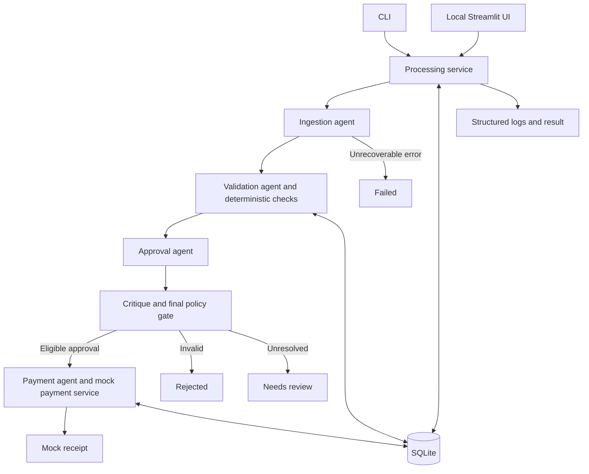

# System design

Status: proposed architecture; no application components are implemented yet.

Related: [requirements](requirements.md), [constraints](contraints.md), [stack](techstack.md).

## Architecture

Use one local Python application with a shared application service accessed by the CLI and Streamlit UI. LangGraph coordinates explicit agent stages; SQLite stores inventory, invoice records, runs, decisions, and mock receipts. Deterministic services own arithmetic, inventory checks, and payment eligibility.

All transitions write audit events. Duplicate detection occurs after identity extraction and again transactionally at payment. Technical errors in any stage produce `failed` without payment.

## Agent responsibilities and tools

| Agent | Responsibility | Permitted capabilities |
| --- | --- | --- |
| Ingestion | Route format, extract fields, propose normalization, repair malformed extraction once. | Bounded file-text extraction, schema validation, known alias lookup. |
| Validation | Explain findings from authoritative checks; request targeted evidence when needed. | Read-only inventory lookup, deterministic arithmetic, required-field/date checks, duplicate lookup. |
| Approval | Apply policy to findings and propose approve/reject/review with evidence. Critique challenges omissions and unsupported conclusions. | Read validation evidence and policy; produce structured recommendation and critique. |
| Payment | Execute the final eligible outcome and return a mock receipt or rejection/review record. | Guarded mock-payment service only; no model-controlled bank calls. |

In live mode, reasoning agents use typed model outputs and whitelisted function calls. Tool requests execute through an application dispatcher that validates arguments and authorization. Offline mode simulates those reasoning responses explicitly; deterministic services and graph contracts remain shared. A deterministic payment agent is intentional: model creativity is not useful at the execution boundary.

## Processing sequence

1. Validate path, format, and limits; assign run ID; hash input bytes; persist source metadata.
2. Extract text or structured records. JSON/CSV/XML use native parsers; PDFs use text extraction; TXT is decoded with explicit errors.
3. Build a draft invoice that can retain invalid or missing values and extraction issues. Do not discard malformed evidence merely because a strict payable schema rejects it.
4. Normalize known formats and aliases. Store raw value, normalized value, evidence location, and rule/model provenance for every change.
5. Validate the normalized draft, aggregate item quantities, query inventory, and reconcile totals. Persist all findings.
6. Check vendor/invoice identity against prior inputs and payments. Identical business content is a duplicate; changed content enters revision/conflict handling.
7. Generate initial approval recommendation. Critique checks evidence completeness, high-value scrutiny, unresolved fields, and policy compliance. Allow one revised recommendation.
8. Run an independent deterministic eligibility gate. Any blocker prevents payment regardless of the recommendation. Unresolved contradictions go to review.
9. For approval, the payment service rereads persisted validation and decision state and atomically creates or returns the mock receipt.
10. Persist terminal result and emit structured output to the CLI or UI.

Do not expose hidden model reasoning. Store short decision summaries, failed/passed rules, and cited evidence sufficient to explain the result.

## Core data contracts

- `SourceDocument`: source ID, content hash, original name, format, page/row references, extracted text, parser version.
- `InvoiceDraft`: raw vendor/number/dates/currency, line fields, stated monetary fields, missing/invalid-field findings, and source evidence.
- `NormalizedInvoice`: canonical vendor key, invoice number, optional revision, normalized dates/currency, line items, stated totals, computed totals, and normalization events. Decimal amounts serialize as strings.
- `ValidationFinding`: stable code, severity (`info`, `warning`, `blocker`), field/item, expected/observed values, evidence, and resolution status.
- `ApprovalDecision`: initial and final recommendation, critique summary, reasons, policy version, execution mode, provider/model where relevant.
- `ProcessingResult`: run ID, invoice ID, terminal status, findings, decision, optional mock receipt, timings, and errors.

Proposed lifecycle states: `received`, `extracted`, `validated`, `approval_pending`, `approved`, then `paid_mock`; alternate terminal outcomes are `rejected`, `needs_review`, `failed`, and `duplicate`. Approval is not proof of payment. Repeated files may have distinct runs while sharing one business invoice identity.

## Persistence and transaction boundaries

Use one SQLite database, initially `inventory.db`, with these logical tables:

| Table | Purpose |
| --- | --- |
| `inventory` | Required canonical item/stock records. Seed idempotently without silently resetting existing data. |
| `sources` | Unique file hashes and extraction metadata. |
| `invoices` | Business identity: normalized vendor plus invoice number; selected version and current status. |
| `invoice_versions` | Revision, normalized payload, semantic hash, original source references. |
| `runs` | One processing attempt, mode, versions, state, timestamps, and errors. |
| `findings` | Validation evidence associated with a run/version. |
| `decisions` | Recommendations, critique summaries, and final policy decision. |
| `payments` | Unique business invoice identity, selected version, decimal amount, currency, mock status, receipt. |
| `audit_events` | Ordered events associated with run, invoice version, and actor/stage. |

Canonical identity normalization must be conservative: case/whitespace normalization and evidenced invoice-number formatting, not fuzzy vendor merging. Semantic hash excludes file layout and source filename but includes payable content. Store normalization versions so future changes can be audited.

For the local mock, acquire a write transaction, verify eligibility and absence of an existing payment, create the simulated receipt and payment record, write the payment audit event, then commit. A uniqueness constraint enforces one payment per business invoice identity even across simultaneous calls. The mock has no external side effect outside this transaction. A future real payment service would require a provider idempotency key and reconciliation design.

Revision policy:

- Identical content: return prior outcome; no new payment.
- Different content under the same identity: mark conflict/revision for review before payment; never pick whichever file was processed last.
- A revised invoice processed alone may pass normal checks, but later related versions cannot generate another payment.
- Previously paid identity: block all additional versions; no automatic adjustments, refunds, or extra charges.

MVP does not implement human conflict resolution; the UI explains why the invoice needs review.

## Failure handling and observability

- Separate extraction errors, business blockers, model errors, and mock-payment errors.
- Apply the call, timeout, and input limits from [constraints](contraints.md).
- A process restart can rerun an input safely because duplicate/payment state is persistent; seamless resumption of every graph node is not an MVP promise.
- Emit JSONL events with stage, run ID, source identity, status, duration, mode, and concise error/finding codes. Emit a final JSON result separately from human-readable diagnostics.
- Do not log API keys, entire environment variables, or hidden reasoning. Full invoice text remains local and is sent to a hosted model only in explicitly selected live mode.
- Offline tests must fail on attempted network access. Live failures remain visible and do not become simulated successes.

## Interface

CLI preserves `python main.py --invoice_path=...`. Proposed additional options: execution mode, database path, output path, and explicit evaluation date. Final option names are to be fixed during implementation.

Streamlit calls the same application service directly. Show mode, source preview, extracted data, normalized changes, inventory/arithmetic findings, decision/critique summary, and mock receipt. Dashboard counts distinguish documents, unique invoices, runs, and paid invoices to avoid inflated metrics. A review list is informational in MVP.

## Verification and delivery order

1. Define schemas, pure validation functions, and idempotent seed setup.
2. Deliver one clean TXT invoice through offline CLI to a persisted mock receipt.
3. Add all formats, sample acceptance cases, revision conflicts, and repeat-run protection.
4. Add bounded live reasoning/tool integration and critique tests; label actual provider verification separately.
5. Build Streamlit views using the tested processing service.
6. Run the whole corpus, error injection, malformed-input, payment-replay, threshold-boundary, and offline-network tests; document results and limitations.

Use generated variations, not filename-specific decisions. Test model behavior with controlled invalid/valid outputs and an optional live smoke test; assert business invariants rather than exact prose.
